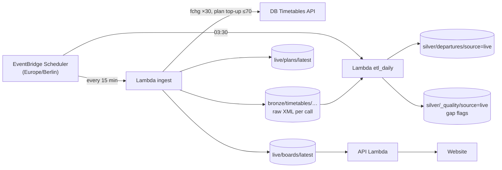

# Phase 7 — Live data pipeline

Branch `phase-7/live-pipeline` · built 2026-11-12 → 11-18 · live on the public site since 2026-11-18 17:20 UTC.

## 1. Goal

Until Phase 6 the website showed a *sample* board: a real past day replayed onto "now". Phase 7 replaces it
with **real departures** from the Deutsche Bahn Timetables API, refreshed every 15 minutes, and turns every
day into **labelled training data** (silver) with exactly the same rules as the historical Hugging Face (HF)
data the model learned from.

The hard part is not fetching data, it is trusting it. The DB API only tells you when something *changed*;
"no change reported" means "on time". If ingestion misses data, late trains silently look punctual. So this
phase also had to **detect gaps** and **prove** the live data matches the history.

## 2. What was built

| Piece | Files | Why |
|---|---|---|
| API client + rate limit | `src/dbdelay/timetables/client.py`, `ratelimit.py` | httpx with 10 s timeouts; retries only for 429/5xx/network errors (max 3, backoff + jitter); every attempt passes a 50 calls/min limiter (DB free plan allows 60). |
| Safe XML parser | `src/dbdelay/timetables/parser.py` | `defusedxml` only (no entity bombs). Turns `plan` and `fchg` responses into typed stop events; Berlin times → UTC; times that are ambiguous/missing on DST days are dropped and counted. |
| Raw data (bronze) | `src/dbdelay/timetables/bronze.py` | One gzip JSON-lines file per run and kind, one line per API call, raw XML kept: everything can be rebuilt later. |
| Timetable store | `src/dbdelay/live/plans.py` | Planned trains for Berlin hours from 3 h ago to 6 h ahead; each run fetches only missing hours, nearest first, at most 70 calls. |
| Live board | `src/dbdelay/live/board.py` | Timetable + latest changes → the same board file the API already read (`source="live"`), now with `via` (stops ahead). |
| Ingest run | `src/dbdelay/live/ingest.py`, `services/jobs/ingest_handler.py` | Every 15 min: changes for 30 stations, timetable top-up, bronze, store, board. Stops starting calls when time runs short; one failed station keeps its previous live rows. |
| Nightly ETL | `src/dbdelay/live/etl.py`, `conform.py`, `quality.py`, `services/jobs/etl_handler.py` | 03:30 Berlin: yesterday's bronze → silver `source=live` (same schema and checks as HF) + a quality report that flags gaps. |
| Parity + reconciliation | `src/dbdelay/live/parity.py`, `hf_raw.py`, `reconcile.py` | Compare our results with HF's own scrape (`make parity-check`, `make reconcile`). |
| Cloud | `infra/` (jobs ECR, 2 Lambdas, 2 schedules, 4 alarms, `board_mode`) | Same laptop deploy flow as Phase 6; DB API keys in SSM SecureString, never in Terraform. |
| Website | `frontend/src/lib/destinations.ts` | "Going to (any stop on the way)": a train to Berlin via Bamberg now matches "Bamberg". |

## 3. How it works



- **Latest observation wins.** A train cancelled at 10:00 and reinstated at 10:15 is not cancelled.
- **Gap rule:** a departure counts as *covered* if its station had a successful change request within 3 hours
  after the planned time (the changes feed reaches 11–18 h back). Uncovered departures flag that station-day;
  an hour where *all* stations are uncovered is flagged too. Training already skips flagged days and hours.

## 4. Key decisions and why

- **Parity before going live.** HF publishes its raw API responses. Running *our* code on an August day and
  comparing with the HF silver we trained on showed two rule differences (HF keeps trains seen only in the
  changes feed; HF's destination is the last *planned* stop). After fixing both: 100 % identical.
- **One run every 15 min** instead of an hourly plan run plus a 15-min change run: two runs could exceed the
  API limit together.
- **Hidden candidate board first.** For 4 days the live board was written next to the public sample board;
  only then did `board_mode = "live"` switch the site. Switching back is one setting.
- **Keys outside Terraform.** The AWS provider copies SecureString values into Terraform state on every
  refresh, so Terraform only knows the parameter names (found by the final review; fixed).

## 5. How it was tested

| Check | Result |
|---|---|
| `make check` (ruff, mypy, pytest) | 571 passed, coverage 97 % |
| `make web-check` | 70 passed |
| `make tf-scan` | 0 findings |
| Parity 2026-08-24 / 08-25 (HF raw → our code vs HF silver) | 13,795 / 13,718 rows, 100 % found; delay, late/on-time, destination 100 %; cancelled 99.86 % / 99.74 % |
| Local ingest (real API → MinIO) | 100 calls in 70.5 s, 0 failures |
| AWS ingest | top-up runs 65 s, 266–301 MB; changes-only runs ~7 s |
| Nightly ETL 14–17 Nov (AWS) | 11,416–14,178 rows/day, 178–262 s, 349–402 MB, 0 flagged or empty stations |
| Reconciliation 15/16/17 Nov (live vs HF raw) | **PASS** all: HF rows found 100 %; late/on-time agreement 99.2 % / 95.5 % / 97.1 % (threshold 95 %) |
| `make smoke-prod-live` | 10/10 |
| Headless Chrome on the public page | "Live · Updated 18:20", 0 CSP violations |

**What the reconciliation revealed.** Where live and HF disagree on a delay, live has the *later* delay in
95 % of rows; on 16 Nov HF reported 0 minutes for 1,727 trains that live saw delayed (579 late in live but
on time in HF, only 8 the other way). HF fetches the changes feed about 5 times a day and misses updates —
so the **historical training data probably undercounts late trains**. Live data is more complete.

## 6. How to run it

Local (needs `make up` and DB API keys in `.env`):

```bash
make parity-check DAY=2026-08-24   # HF raw through our code vs HF silver
make ingest-local                  # one real ingest run into MinIO
make etl-live-local DAY=2026-11-12 # bronze -> silver for one UTC day
```

Cloud (laptop, `aws login --profile puenktlich`): see README §10 step 8. Daily checks:
`make smoke-prod-live`; reconciliation for days HF has published: `make reconcile DAYS="2026-11-15 2026-11-16"`.
Back to the sample board: `board_mode = "sample"` in `infra/envs/prod/terraform.auto.tfvars` → `make tf-plan` → `make tf-apply`.

## 7. Known gaps

- Owner action: delete 4 old Terraform state versions that still contain the DB API keys, then rotate the keys.
- HF history likely undercounts lateness (see §5) — to weigh in Phase 9 when retraining on live data.
- Nightly ETL memory peaked at 402 MB of 512 MB and is rising with daily volume — watch it.
- Rolling the API back to a pre-Phase-7 image would reject live boards (they carry `via`): switch to the sample
  board first. Don't run `make ingest-local` while prod ingests (shared 60 calls/min key).
- A valid but empty changes reply still counts as coverage; ~0.1–0.3 % cancellation mismatch vs HF unexplained.

## 8. What's next

Phase 8 — CI/CD. First decision (owner): how GitHub may deploy to this AWS account, because the account blocks
GitHub OIDC (ADR 0002: laptop-only deploys, Paid plan + advanced features, or a new classic account).
