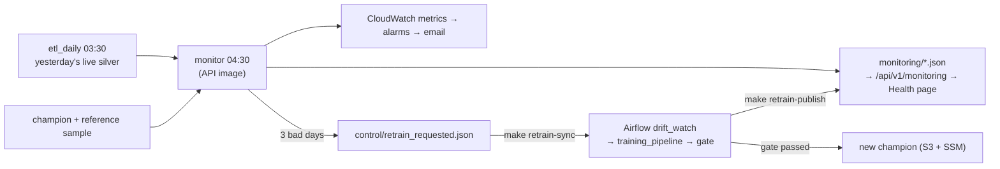

# Phase 9 — Monitoring & continuous training

Branch `phase-9/monitoring` · 2026-11-18 → 11-19.
Spec `docs/superpowers/specs/2026-11-18-phase-9-monitoring-design.md`, plan `docs/superpowers/plans/2026-11-18-phase-9-monitoring.md`.

## 1. Goal

The model should be checked every day against what really happened, and retrained when it goes stale — and the
public Model Health page should show all of it. Since Phase 7 every day of live departures becomes labelled data,
so for the first time we can score **all of yesterday's trains** and compare the predictions with reality.

## 2. What was built

| Piece | Where | Why |
|---|---|---|
| Daily metrics | `src/dbdelay/monitoring/performance.py` | Brier, ROC-AUC, log loss, ECE, actual vs predicted late rate — the same definitions as training, without scikit-learn (the API image has none). |
| Drift | `src/dbdelay/monitoring/drift.py` | Evidently's own default tests (Wasserstein / Jensen–Shannon, threshold 0.1), computed with scipy. |
| History + trigger | `history.py`, `triggers.py`, `job.py` | One result per day; 3 bad days in a row (same reason, same model) → retrain request. |
| Monitor Lambda | `services/api/monitor_handler.py`, `infra/envs/prod/main.tf` | Runs on the API image every day at 04:30 Berlin, after the nightly ETL. |
| API | `GET /api/v1/monitoring` | Health-page data: newest day in full, the history, retrain decisions. |
| Alarms | `infra/modules/observability` | Monitor missing, drift, performance (9 alarms in total, free tier). |
| Retrain loop | `src/dbdelay/monitoring/{sync,control}.py`, `pipelines/airflow/dags/drift_watch.py` | Laptop sync → Airflow → training → gate → publish. |
| Training on live data | `src/dbdelay/training/split.py`, `src/dbdelay/live/hf_raw_fill.py` | HF + live silver (live wins per day); missing November days rebuilt from HF's raw scrape. |
| Health page | `frontend/src/components/health/` | Status, 4 daily charts (each with a data table), drift table, retrain log. |
| Runbook | `docs/runbook.md` | Every alarm: meaning → first checks → fix. |

## 3. How it works



- **Which rows count:** cancelled trains and trains in flagged ingestion gaps are dropped (the same rule training
  uses). A day with fewer than 2,000 remaining trains is `too_few_rows` and never counts towards a retrain.
- **Drift share:** the share of the 7 content inputs (station, train type, line, destination, stop position, hour,
  minute) that drifted. Calendar inputs (weekday, month, …) always differ on a single day, so they are shown but
  not counted.
- **Retrain request:** the last 3 calendar days, same model, all with drift share > 0.30 or all with a Brier score
  > 1.10 × the champion's test Brier. A new request needs a fresh streak that does not overlap the last one.
- **Route A:** Airflow never talks to AWS. The laptop copies data and the flag in (`make retrain-sync`) and the
  decision (and a gate-approved model) out (`make retrain-publish`).

## 4. Key decisions and why

- **No Evidently in Lambda** (ADR 0003): measured +177 MB memory and +7.7 s import; the Lambda has 512 MB and the
  same image serves the public API. scipy (already in the image) computes the same tests.
- **Monitor on the API image:** it needs LightGBM, which only that image has; no new dependency.
- **Results through the API:** the web bucket is replaced on every website deploy.
- **Calendar inputs not counted** in the drift share (see §3).
- **Gate unchanged:** a retrained model replaces the champion only if it passes the Phase 4 gate.

## 5. How it was tested (real results)

| Check | Result |
|---|---|
| `make check` | 676 passed, coverage 96.15 % |
| `make web-check` | 86 passed; npm audit 0 high |
| `make test-dags`, `make tf-scan`, tflint | passed / exit 0 / 0 issues |
| AWS apply | 9 added, 4 changed, 0 destroyed |
| Monitor on AWS, 13–17 Nov | 7.1–10.7 s, 361–464 MB of 512 MB |
| `make smoke-prod-live` | 11/11 (new check `monitoring_served`) |
| Health page, headless Chrome | real data, 0 CSP errors (desktop + phone width) |
| Final review (opus) | 0 Critical; 2 Important + 1 re-graded fixed test-first; 6 minors deferred |

**What the real data shows (14–17 Nov):**
- The model **underestimates lateness**: actual late rate 22–33 %, predicted 19–23 %. Brier ratio 1.05, 0.97, 1.24,
  1.31. This fits the Phase 7 finding that HF history probably undercounts late trains.
- **Real drift:** drift share 0.43–0.57. Destinations (0.31–0.33) and lines (0.22–0.23) differ far beyond sampling
  noise (0.10 and 0.08, measured between two halves of the training sample), as do train types and stop positions.

**The loop, end to end, on a real event:** the AWS monitor raised a drift request after 14–16 Nov →
`make retrain-sync` → `drift_watch` → `training_pipeline` on HF + live data (test 4–17 Nov, 150,530 trains) →
gate **rejected** challenger v6. It was better overall (Brier 0.1477 vs 0.1555, ROC-AUC 0.800 vs 0.781, ECE 0.013
vs 0.040) but its ROC-AUC for one train type (NBE) dropped by 0.053, above the 0.02 slice limit. The champion stays v1.

**Bugs found by the real runs:** the first live day (13 Nov) had every station-day flagged and crashed the monitor
(fixed: `too_few_rows`); the Phase 8 SQLAlchemy 2.1 upgrade broke the local MLflow server (fixed: explicit
`postgresql+psycopg2://`).

**Follow-up the same day (owner: relax the slice rule):** the per-train-type check now judges only train types
with at least 2,000 test trains (NBE had 797, both models near chance on it). The re-run (window ending 18 Nov)
produced challenger **v7**, which passed every check: Brier 0.1500 vs 0.1586, ROC-AUC 0.7996 vs 0.7805, ECE 0.0158
vs 0.0469. `make retrain-publish` made **v7 the live model** (SSM pointer 1 → 7) and put both decisions on the
health page. Also found and fixed: the first scheduled 03:30 run failed on EventBridge Scheduler's event envelope.

## 6. How to run it

```bash
make monitor-local DAY=2026-11-17          # monitor one day against local MinIO
make hf-raw-fill FROM=2026-11-01 TO=2026-11-12   # silver days from HF raw (one month per run)
make retrain-sync                          # AWS live silver + retrain flag -> MinIO   (aws login)
make airflow-up                            # drift_watch picks the flag up within 30 min
make retrain-publish                       # decision -> health page; gate-approved model -> prod
aws lambda invoke --function-name puenktlich-monitor --payload '{"day":"YYYY-MM-DD"}' \
  --cli-binary-format raw-in-base64-out out.json --profile puenktlich --region eu-north-1   # re-run a day
```

## 7. Known gaps

- Airflow tasks die when the PC sleeps (expired task token) — keep the laptop awake during a retrain.
- Monitor memory 464 of 512 MB.
- Deferred minors (CHANGELOG): flag copy order in sync, scheduled decision ids, top-level JSON null, narrower monitor
  `PutObject`, chart x-axis by index, fill-report traceback.

## 8. What's next

Phase 10 — hardening & showcase: security review, threat model, model card, accessibility pass, documentation.
